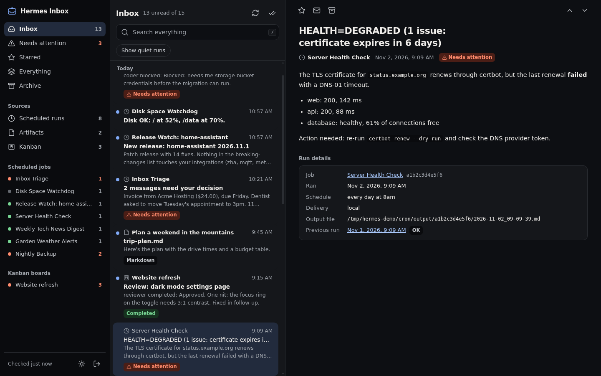
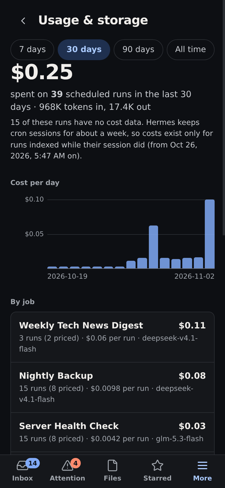
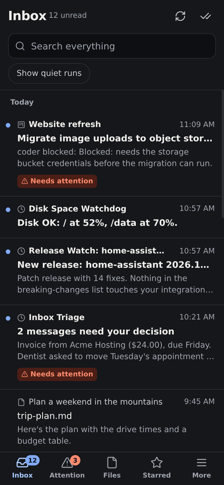
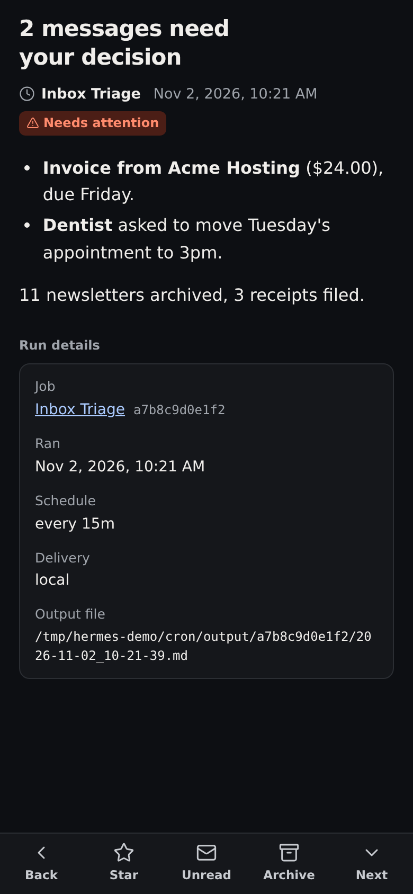
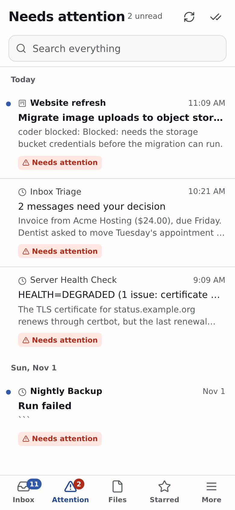
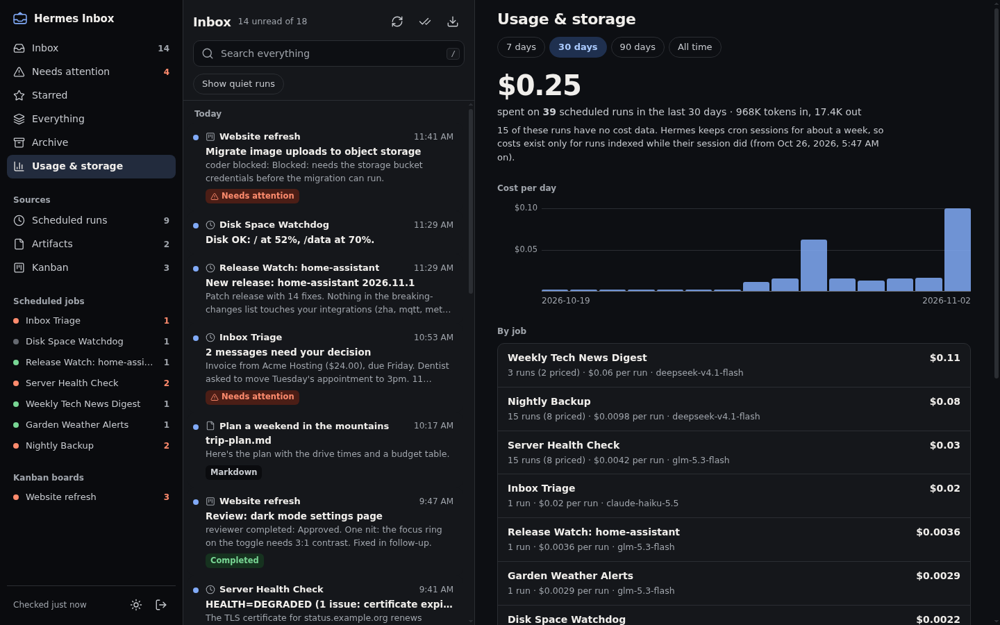

<div align="center">


# Hermes Inbox

**One inbox for everything your [Hermes Agent](https://github.com/NousResearch/hermes-agent) does.**

Cron results, files the agent hands you in chat, kanban hand-offs and your own notes, in a fast mail-style web app that works just as well on your phone. It also shows what each scheduled job costs you.

[](https://github.com/jcrabapple/hermes-inbox/actions/workflows/tests.yml)


</div>



<p align="center">
  
  
  
  
</p>

<sub>Screenshots use the bundled demo data (`tools/demo_home.py`); nothing in them is real.</sub>

## Why

A busy Hermes setup produces a lot: dozens of scheduled jobs, reports, alerts, files
shared across Telegram, Discord, the desktop app and the CLI, plus kanban workers handing
tasks back and forth. That output ends up scattered across chat channels and
`~/.hermes/cron/output`, and Hermes rotates both. Hermes Inbox gathers all of it in one
place, keeps its own copy, and lets you triage it like email: read, star, archive, search.

## What lands in it

| Source | Read from | One item per |
|---|---|---|
| **Scheduled runs** | `cron/output/<job>/*.md` in your Hermes home and every profile | run |
| **Artifacts** | `MEDIA:<path>` and `::preview{file=…}` in assistant messages (`state.db`, every profile), kanban artifacts and task attachments | file (re-shares merge; an edited file comes back unread) |
| **Kanban** | finished `task_runs` across `kanban.db` and `kanban/boards/*/kanban.db` | worker run |
| **Job health** | `cron/jobs.json` in every profile: `next_run_at`, `failure_streak`, `last_error` | broken job, not broken run |
| **Notes** | `hermes-inbox post …` or `POST /api/notes` from any script | note |

Hermes databases are opened **read-only**. Nothing under your Hermes home is ever written.

## Features

- **Noise control.** Runs skipped by a script gate, `[SILENT]` runs, and runs whose output
  matches the previous run (ignoring timestamps and counters) stay out of the inbox. They're
  still visible inside each job.
- **What changed since the last run.** Every run can show a line diff against the previous
  run of the same job, so a monitoring report that grew one line shows you that line.
- **Job health.** The inbox only sees runs that wrote a file, so a job that stopped firing
  is invisible. Job health reads `jobs.json` and opens one item per broken job: overdue
  (`next_run_at` an hour past, or three intervals for fast jobs), or two or more failures
  in a row. The item keeps its original start time instead of piling up a copy per index
  pass, and it archives itself with a "Resolved" note when the job recovers, is disabled,
  or is deleted. For jobs with no recorded run, this is the only way the inbox learns they
  exist.
- **Snooze.** Postpone an item for an hour, until tomorrow morning or a week, and it leaves
  every view until then (there is a Snoozed view, and items come back on their own). Unlike
  archive, a snooze changes nothing about the item; unlike read, it does not pretend you
  looked at it.
- **Every profile, one inbox.** Cron jobs, artifacts and state from all Hermes profiles
  (`~/.hermes/profiles/*`) are indexed alongside the default home and tagged with the
  profile name. Once a second profile has cron activity, a filter row appears at the top
  of the inbox to scope the feed to one profile.
- **Needs attention.** Failed runs, blocked or abandoned kanban tasks, and reports that open
  with DEGRADED, FAILED, "action needed", "needs your decision" or a leading warning emoji
  are flagged. Negations like "no action needed" aren't. In a streak of identical alerts only
  the first one is flagged.
- **Rich previews.** Markdown rendered, images, PDFs, HTML (sandboxed), audio/video,
  text and code, with Open and Download.
- **Model and cost per run.** Each scheduled run shows the model, tokens (in, cached, out,
  reasoning), duration and cost, including auxiliary calls like compression, read from
  Hermes' own session records. The **Usage** page totals cost per job, per model and per
  day for 7, 30 or 90 days, and each job's view shows what it has cost so far.
- **Retention and export.** Quiet runs are deleted after 30 days by default and starred
  items never are. Both windows are configurable. Export any view as JSON or CSV from the
  web app, the CLI or the API.
- **Live refresh.** The browser fingerprints the sources every few seconds and the server
  re-indexes only when one actually changed, so new items appear within seconds without
  busy-polling.
- **Full-text search** (SQLite FTS5) over everything, including runs whose output files
  Hermes has since deleted.
- **Phone-first UI.** Bottom tab bar, bottom action bar in the reader, swipe right to toggle
  read, swipe left to archive (with Undo), 44px touch targets, safe-area aware. Installable
  to the home screen.
- **Dark by default, light on demand.** Every text/surface pair in both themes passes WCAG
  AA (body text passes AAA), checked by `tools/contrast.py` in CI.
- **Keyboard on desktop.** `j`/`k` move, `e` archive, `s` star, `u` unread, `/` search,
  `Shift+I` mark the view read.
- **Zero dependencies.** Python standard library on the server, vanilla JS in the browser
  (marked and DOMPurify vendored).

## Quick start

Requires Python 3.10+ with SQLite FTS5 (standard in python.org builds and every major
Linux distro) on the machine where Hermes runs.

```bash
pipx install git+https://github.com/jcrabapple/hermes-inbox.git
hermes-inbox serve            # http://127.0.0.1:8941
hermes-inbox token --show     # the login token (generated on first run)
```

Or straight from a clone, no install:

```bash
git clone https://github.com/jcrabapple/hermes-inbox.git && cd hermes-inbox
python3 -m hermes_inbox serve
```

The first index pass takes a few seconds. Anything older than 48 hours is filed as read
so you start with recent activity, not months of backlog. After that it checks for new
items every 60 seconds.

### Try it with demo data

```bash
python3 tools/demo_home.py /tmp/hermes-demo
HERMES_INBOX_DATA=/tmp/hermes-demo/inbox HERMES_INBOX_TOKEN=demo \
  python3 -m hermes_inbox --hermes-home /tmp/hermes-demo serve --port 8950
# open http://127.0.0.1:8950 and sign in with "demo"
```

## Configuration

Everything is optional.

| Variable / flag | Default | Purpose |
|---|---|---|
| `--hermes-home`, `HERMES_HOME` | `~/.hermes` | Hermes home to index (profiles under `profiles/` are picked up automatically) |
| `--host`, `HERMES_INBOX_HOST` | `127.0.0.1` | Bind address |
| `--port`, `HERMES_INBOX_PORT` | `8941` | Port |
| `HERMES_INBOX_DATA` | `$XDG_DATA_HOME/hermes-inbox` | Where `inbox.db` lives (mode 600) |
| `HERMES_INBOX_CONFIG` | `$XDG_CONFIG_HOME/hermes-inbox` | Where the `token` file lives (mode 600) |
| `HERMES_INBOX_TOKEN` | *(token file)* | Use this token instead of the file |
| `HERMES_INBOX_INTERVAL` | `60` | Seconds between index passes |
| `HERMES_INBOX_KEEP_QUIET_DAYS` | `30` | Delete quiet runs (skipped, silent, unchanged) older than this. `0` keeps them forever |
| `HERMES_INBOX_KEEP_DAYS` | `0` | Delete every unstarred item older than this. `0` keeps them forever |

## Running it as a service

`deploy/hermes-inbox.service` is a systemd **user** unit:

```bash
cp deploy/hermes-inbox.service ~/.config/systemd/user/
# edit WorkingDirectory/ExecStart to match how you installed it
systemctl --user daemon-reload && systemctl --user enable --now hermes-inbox
```

### Reaching it from your phone

The inbox holds copies of your agent's reports and the files it shared with you, so keep
it private. In order of preference:

1. **A private network** (Tailscale, WireGuard): leave it bound to `127.0.0.1` and use
   `tailscale serve`, or bind to the tailnet address.
2. **A tunnel with an access layer** (Cloudflare Tunnel plus Cloudflare Access, or any
   reverse proxy with SSO in front).
3. **A plain HTTPS reverse proxy or tunnel.** The app's own token login is the only
   lock then. The token is 256 bits of randomness, so guessing it isn't practical, but
   don't skip TLS.

Example Cloudflare Tunnel ingress:

```yaml
ingress:
  - hostname: inbox.example.com
    service: http://127.0.0.1:8941
  - service: http_status:404
```

## Posting your own notes

Anything without a better home (script alerts, deploy notices, reminders) can go into the
inbox:

```bash
hermes-inbox post "Disk almost full" -b "/var at 91%" --level attention --group "Disk watch"
echo "**v1.4** is live" | hermes-inbox post "Deploy finished" - --link https://example.com/releases
```

Or over HTTP with the token:

```bash
curl -H "Authorization: Bearer $(hermes-inbox token --show)" \
     -H 'Content-Type: application/json' \
     -d '{"title":"Deploy finished","body":"**v1.4** is live","level":"info","group":"Deploys"}' \
     http://127.0.0.1:8941/api/notes
```

`level` is `info`, `attention`, `warning` or `error`; anything other than `info` shows
under Needs attention.

## HTTP API

Authenticate with `Authorization: Bearer <token>` or the session cookie. Writes need a
JSON body.

| Method | Path | |
|---|---|---|
| `GET` | `/api/summary` | Counts per view, source and job; last index pass |
| `GET` | `/api/items?view=&source=&group=&profile=&q=&ftype=&noise=1&before=` | Paged list. `view`: `inbox`, `attention`, `starred`, `snoozed`, `all`, `archive` |
| `GET` | `/api/items/<id>` | One item with its full body |
| `GET` | `/api/items/<id>/file[?download=1]` | An artifact's file (only paths the agent published) |
| `POST` | `/api/items/<id>` | `{"read": bool, "starred": bool, "archived": bool, "snoozed_until": epoch}`. `snoozed_until: null` brings it back; a past time is rejected |
| `POST` | `/api/bulk` | `{"action": "read"\|"unread"\|"archive"\|"unarchive", "ids": [...] \| "filter": {...}}` |
| `POST` | `/api/notes` | Create a note |
| `POST` | `/api/reindex` | Index now |
| `GET` | `/api/jobs` | Cron jobs from every profile's `jobs.json` |
| `GET` | `/api/usage?days=30` | Cost and tokens per job, model and day, plus storage and retention status (`days=0` for all time) |
| `GET` | `/api/export?format=json\|csv&view=&source=&group=&q=` | Download items matching the same filters as `/api/items`. CSV leaves out bodies unless `body=1` |
| `POST` | `/api/prune` | Apply the retention policy now (`{"dry_run": true}` to preview) |

## CLI

```
hermes-inbox [--hermes-home DIR] serve [--host H] [--port P]
hermes-inbox index          one index pass, prints how many new items it found
hermes-inbox post TITLE [-b BODY | -] [--level L] [--group NAME] [--link URL]
hermes-inbox stats          item counts per source
hermes-inbox doctor         check sources, database and config; exit 1 on failure
hermes-inbox retitle        recompute run subjects after changing the subject rules
hermes-inbox token [--show] where the login token lives, or the token itself
hermes-inbox usage [--days 30]                       cost and models per scheduled job
hermes-inbox prune [--dry-run] [--quiet-days N] [--keep-days N]
hermes-inbox export [--format json|csv] [--view all] [--source cron] [--group JOB] [--since 30d] [-o FILE]
```

## Cost data: what to expect



Hermes records token counts and an estimated cost (or the provider's actual bill, when it
reports one) on each cron session, and prunes cron sessions after about a week. Hermes
Inbox matches each run to its session as soon as the run lands and keeps the numbers, so
**costs build up from the day you install it**. Runs that were already older than
Hermes' session retention show as having no cost data. Script-only jobs and runs skipped
by a script gate never call a model, so they have no cost.

## Security

- **Login.** One random token per install. The session cookie is an HMAC of it (HttpOnly,
  SameSite=Lax, Secure behind HTTPS). To rotate, delete the token file and restart; every
  session is signed out.
- **File access.** Files are allowlisted by the database. Only paths the agent itself
  published (assistant `MEDIA:` lines, kanban artifacts) can be served. Paths users paste
  into chat are not.
- **Untrusted content.** HTML and SVG artifacts are served with
  `Content-Security-Policy: sandbox`, so they run in an opaque origin and can't call the
  API with your cookie. Markdown is sanitized with DOMPurify.
- **CSRF.** Cookie-authenticated writes must be `application/json`, which a cross-site form
  can't send without a preflight.
- **Storage.** The inbox database and token file are created owner-only (600, in 700
  directories). Exports are only available to an authenticated session and are
  served as downloads, never cached. CSV cells that start with `=`, `+`, `-` or `@` are
  prefixed with `'` so spreadsheets don't run them as formulas.

## How it works

```
~/.hermes ──read-only──▶ indexer (every 60s, per-source cursors)
  cron/output/*/*.md            │
  cron/jobs.json (health)       │
  state.db  (MEDIA:, costs)     ▼
  kanban/**/kanban.db     inbox.db (SQLite + FTS5, read/star/archive/snooze state)
                                │
                                ▼
                     stdlib HTTP server ──▶ single-page app (vanilla JS)
```

```
hermes_inbox/
  cli.py        CLI entry point
  server.py     HTTP server, auth, JSON API, file serving
  indexer.py    incremental indexing with per-source cursors
  sources.py    readers for cron output, jobs.json, state.db and kanban
  usage.py      matches cron runs to Hermes sessions for model, tokens and cost
  retention.py  pruning policy and storage stats
  export.py     JSON and CSV export
  store.py      schema, migrations, FTS5, upserts
  static/       the web app (HTML, CSS, JS, icons, vendored libraries)
tools/
  contrast.py   WCAG contrast check for both themes
  demo_home.py  fake Hermes home for demos and screenshots
tests/          python3 -m unittest discover -s tests
```

## Development

```bash
python3 -m unittest discover -s tests   # behaviour tests against a temp Hermes home
python3 tools/contrast.py               # fails if a colour change breaks contrast
```

To add a source, write a reader in `sources.py` that yields item dicts, add a cursor-based
`_index_<source>` to `indexer.py`, register it in `SOURCE_META` in `static/app.js`, and
cover it in `tests/test_inbox.py`.

## Scope guard

Hermes Inbox is deliberately small. Each release may add **no new runtime dependencies,
no new top-level source module, and no new top-level navigation destination**. A feature
that can't fit inside that budget is a signal to say no, not to relax the rule.

Hermes Inbox reads Hermes Agent's on-disk formats, which are not a stable public API. If
an update to Hermes changes them, please open an issue with a sample.

## License

MIT. See [LICENSE](LICENSE) and [NOTICE.md](NOTICE.md) for vendored code and icons.
Hermes Inbox is an independent project and is not affiliated with Nous Research.
